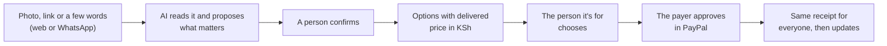
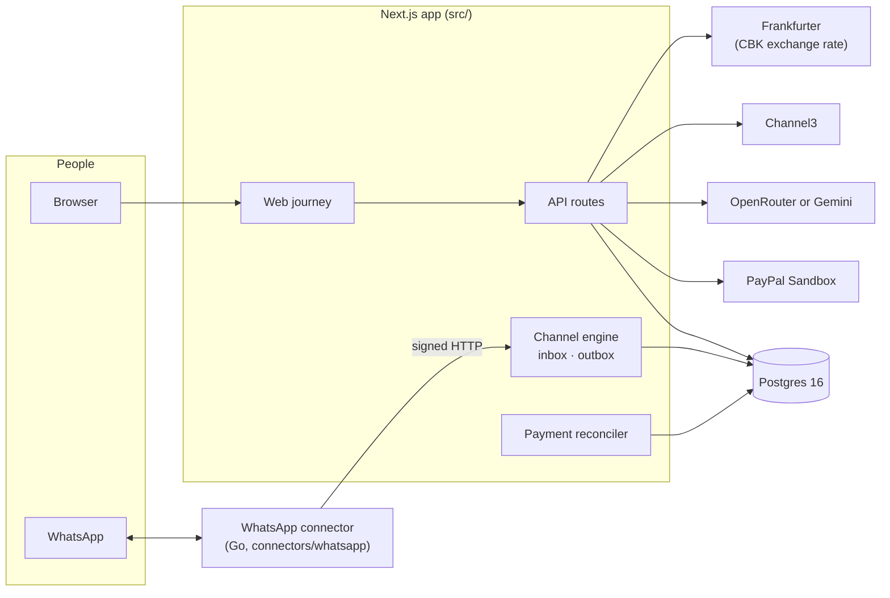
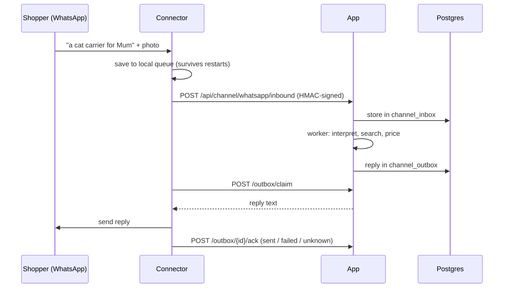
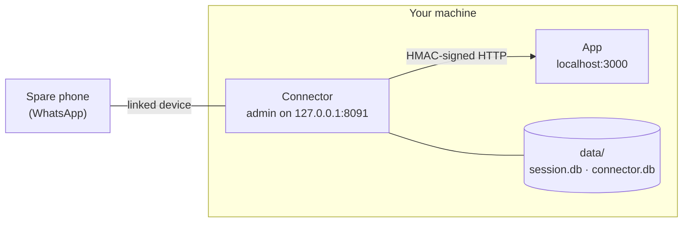

# Dad's Typing

Shopping help that starts in the family chat. Someone sends a photo, a link or a few words.
The assistant works out what matters, finds options with the full cost delivered to Kenya,
the person it's for picks one, and whoever is paying approves the exact item and total with
PayPal. Everyone sees the same receipt.

- **Web app:** https://dads-typing.onrender.com
- **Website:** https://dads-typing-site.onrender.com
- **WhatsApp:** chat with *My Plug* from the website's "Try it live" section

> Payments run in PayPal **Sandbox** only. No real money moves and no real orders are placed.

## How it works



The AI only proposes. People confirm requirements, choose the item and approve the payment.

## Architecture



The engine doesn't know about WhatsApp. A connector posts inbound messages to the app and
sends the replies the app queues, over a signed HTTP bridge. The browser chat, WhatsApp and SMS
all feed the same engine.

### A WhatsApp message, end to end



## How we use PayPal, AI and the sponsor tools

| Tool | What it does here | Code |
|---|---|---|
| **PayPal Developer Platform (Sandbox)** | Orders v2 creates the order for the exact item and total (`intent: CAPTURE`, `PAY_NOW`, item + shipping breakdown) and captures it when the payer returns; both are idempotent with `PayPal-Request-Id`. An order counts as paid only when the capture is COMPLETED and matches the frozen order, merchant, amount and currency. Payments v2 handles refunds and lookups; a reconciler settles lost replies; webhook signatures are verified when `PAYPAL_WEBHOOK_ID` is set. | `src/adapters/paypal.ts`, `src/payments/` |
| **Google Gemini 3.8 Flash via OpenRouter** | Reads the shopper's text and photos into structured JSON: the item to search, proposed requirements quoting their words, and one clarifying question. It also reads quote screenshots and frames from the shopper's own clips. It only proposes; people confirm. | `src/adapters/openrouter.ts`, `src/chat/exchange.ts` |
| **Whisper large v3 turbo via OpenRouter** | Push-to-talk voice transcription, checked by the shopper before sending | `src/adapters/stt.ts` |
| **Google Gemini API** | The same job called directly; switch with `INTERPRETER_PROVIDER=gemini` | `src/adapters/gemini.ts` |
| **Supadata** | Reads public TikTok, Instagram and Facebook videos for the product shown, within a credit cap; the result follows up in the WhatsApp chat | `src/adapters/supadata.ts`, `src/sources/` |
| **Channel3** (sponsor) | Product search across US and UK shops, with weights and sizes where listed, priced delivered to Kenya by `src/delivery` | `src/adapters/channel3.ts` |
| **Render** (sponsor) | Hosts the app (pre-deploy migrations, health check, edge cache), the WhatsApp connector (worker, persistent disk, private network), Postgres 16 (closed to the internet) and the landing page. Deploys run only after CI passes. | `render.yaml` |

## Repository layout

| Path | What it holds |
|---|---|
| `src/app` | Next.js pages and API routes (`src/app/api/...`) |
| `src/domain` | Tasks, requirements, access grants, orders, events |
| `src/channel` | Channel engine: registry, inbox, outbox, replies, JOIN/STOP, the My Plug opener |
| `src/adapters` | PayPal, OpenRouter, Gemini, Channel3, Frankfurter, Supadata, speech-to-text |
| `src/delivery` | Kenya delivered-price model, forwarders, pickup hubs |
| `src/payments` | Capture checks and the reconciler |
| `db/migrations` | SQL migrations, applied in order by `scripts/migrate.mjs` |
| `connectors/whatsapp` | The WhatsApp connector (Go, whatsmeow). Its own README covers the details |
| `scripts` | Migrations, the channel simulator, the provider check, operator refunds |
| `tests` | Unit and integration tests (vitest) and browser tests (Playwright, `tests/e2e`) |
| `website` | The one-page landing site (static HTML) |
| `render.yaml` | The Render setup as a Blueprint |

## Run it locally

### 1. Prerequisites

- Node **22.12+** and npm
- Docker, for Postgres
- `ffmpeg` on your PATH, for checking shoppers' clips (`brew install ffmpeg` or `apt install ffmpeg`).
  Set `CLIP_ANALYSIS=0` to skip it.

### 2. Accounts and keys

| Service | Needed for | Required? | Where to get it | Variables |
|---|---|---|---|---|
| PayPal Developer (Sandbox) | Checkout | Yes | [developer.paypal.com](https://developer.paypal.com) → Apps & Credentials → Sandbox app. Under Testing Tools → Sandbox Accounts, note the **Business** account's merchant id and create a **Personal** buyer to pay with | `PAYPAL_CLIENT_ID`, `PAYPAL_CLIENT_SECRET`, `PAYPAL_MERCHANT_ID` |
| OpenRouter | Understanding messages and photos, voice transcription, clip checks | Yes (or Gemini) | [openrouter.ai](https://openrouter.ai) → Keys | `OPENROUTER_API_KEY`, `OPENROUTER_MODEL`, `STT_MODEL` |
| Google Gemini | Same, called directly instead of OpenRouter | Alternative | [aistudio.google.com](https://aistudio.google.com) → API keys | `INTERPRETER_PROVIDER=gemini`, `GEMINI_API_KEY`, `GEMINI_MODEL` |
| Channel3 | Real products from US and UK shops | Optional | [trychannel3.com](https://trychannel3.com) | `CHANNEL3_API_KEY` |
| WhatsApp | The My Plug chat | Optional | A spare number with WhatsApp installed (see below) | `WHATSAPP_*`, `CHANNEL_OPEN_START` |

The exchange rate comes from [Frankfurter](https://frankfurter.dev) (Central Bank of Kenya rate) and needs no key.

### 3. Start it

```bash
git clone https://github.com/some-casual-coder/Dad-s-Typing.git
cd Dad-s-Typing
npm install
cp .env.example .env.local          # fill in the keys from step 2

docker run -d --name dads-typing-pg -p 127.0.0.1:5433:5432 \
  -e POSTGRES_USER=dt -e POSTGRES_PASSWORD=dt -e POSTGRES_DB=dads_typing \
  postgres:16-alpine                # matches DATABASE_URL in .env.example

npm run db:migrate
npm run dev                         # http://localhost:3000
```

Use `npm run build && npm start` for a production build. Next time, `docker start dads-typing-pg`
brings the database back.

### 4. Try the journey

1. Open `http://localhost:3000`. Choose **Upload photo** and pick a photo of, say, a cat carrier.
   No photo? Use **Download a sample photo** on the same screen. Add a note such as
   "For Mum. It must open from the top", then **Start with this photo**. You can also type a request
   or press **Speak**.
2. The assistant proposes requirements, each with the words it relied on. Nothing applies until a
   person confirms it.
3. Open **Share** → **Send to Mum to choose**, and open that link in a private window (it shares no
   sign-in). As Mum, confirm "it must open from the top": mismatches move to **Doesn't match**.
4. Mum taps **Choose this one**. Your window moves to **Pay** with the exact item, seller and total.
5. Tap **Pay with PayPal (sandbox)** and sign in with your sandbox **Personal** buyer.
6. Both windows show the same receipt. Cancelling at PayPal leaves no receipt, and you can pay again.

## WhatsApp

The connector is a separate Go service in `connectors/whatsapp`. It links to a WhatsApp number as
a **linked device**, the way WhatsApp Web does. It uses [whatsmeow](https://github.com/tulir/whatsmeow),
an unofficial client, so use a **spare number**, not your personal one: WhatsApp can restrict
numbers that behave like bots.

### Try it with no phone

The simulator plays the connector, so you can see the bot's replies in your terminal:

```bash
# .env.local needs WHATSAPP_BRIDGE_SECRET and either CHANNEL_OPEN_START=1
# or your test number in WHATSAPP_ALLOWED_SENDERS. Restart the app after editing it.
node --env-file=.env.local scripts/channel-sim.mjs whatsapp 254700000009 "Hi My Plug! I'd like to try it out."
node --env-file=.env.local scripts/channel-sim.mjs whatsapp 254700000009 "a cat carrier for Mum"
```

### Connect a real number

1. **Set the app's side** in `.env.local`, then restart the app:

   ```bash
   WHATSAPP_BRIDGE_SECRET=<openssl rand -hex 32>
   WHATSAPP_BOT_NUMBER=2547XXXXXXXX     # the spare number, digits only
   CHANNEL_OPEN_START=1                 # anyone who says "Hi My Plug!" gets in
   ```

2. **Run the connector.** Either build it (needs Go 1.25 and a C compiler, because the session is
   stored in SQLite):

   ```bash
   cd connectors/whatsapp
   make build
   export WHATSAPP_BRIDGE_SECRET=<same value as the app>
   export TS_BASE_URL=http://localhost:3000
   export DATA_DIR=$PWD/data && mkdir -p data && chmod 700 data
   export ADMIN_TOKEN=$(openssl rand -hex 24)
   ./bin/connector
   ```

   Or run it in Docker:

   ```bash
   cd connectors/whatsapp && make docker
   docker run -d --name dt-whatsapp \
     -e WHATSAPP_BRIDGE_SECRET=<same value as the app> \
     -e TS_BASE_URL=http://host.docker.internal:3000 -e ALLOW_INSECURE_TS_URL=1 \
     -e ADMIN_TOKEN=$(openssl rand -hex 24) \
     -v dt-whatsapp-data:/data dt-whatsapp-connector
   ```

3. **Pair the number.** In a second terminal (with the same `ADMIN_TOKEN` exported), or with
   `docker exec dt-whatsapp` in front:

   ```bash
   connectors/whatsapp/bin/connector admin POST /pair '{"phone":"2547XXXXXXXX"}'
   ```

   It prints an 8-character code. On the spare phone go to WhatsApp → **Settings → Linked devices →
   Link a device → Link with phone number instead**, then enter the code. To use a QR code instead, run
   `admin POST /pair/qr`, then `admin GET /pair/qr`, and scan the code it prints.

4. **Check it:** `admin GET /status` should show `"connected":true,"paired":true`. From another
   phone, send *Hi My Plug! I'd like to try it out.* to the number. You'll get the intro, then a note
   to save the number as My Plug.



The session lives in `DATA_DIR`, so restarts need no new pairing. Who can chat:

- numbers in `WHATSAPP_ALLOWED_SENDERS`;
- anyone who sends *Hi My Plug!* when `CHANNEL_OPEN_START=1`;
- a payer who sends a `JOIN` code from an order page.

Everyone else is ignored. My Plug is never added to group chats, for privacy: it only reads
what someone chooses to send it. To get help with a family chat, forward the messages to it one
after another (what's needed, a label photo, a budget such as "around KSh 3,000") and it treats
them as one request. Send **NEW** to start a new search, or **DONE** to close the current one.

More detail is in `connectors/whatsapp/README.md` and
`docs/CHANNEL_CONTRACT.md`.

### Add another channel

1. Add an entry to `src/channel/registry.ts`: sender format, reply length, and whether it takes images.
2. Set `CHANNEL_<ID>_SECRET` (32+ characters) and `CHANNEL_<ID>_ALLOWED`.
3. Write a connector. It signs each request with `HMAC-SHA256(secret, ts \n METHOD \n path \n body)`
   (headers `X-DT-Timestamp` and `X-DT-Signature`), posts to `.../inbound`, then claims replies from
   `.../outbox/claim` and acknowledges each one at `.../outbox/{id}/ack`.

## Deploy (Render)

`render.yaml` describes the whole setup:

- the app (Node web service, migrations as a pre-deploy step, `/api/health` check);
- the WhatsApp connector (Docker worker with a 1 GB disk, reaching the app over Render's private
  network);
- Postgres 16;
- the static website.

It all costs about $20 a month on the smallest paid plans.

1. Fork the repo. On Render, choose **New → Blueprint** and pick the fork.
2. Fill in the variables marked `sync: false` (the keys from step 2 above).
3. After the first deploy, open the connector's **Shell** and pair: `connector admin POST /pair '{"phone":"…"}'`.

GitHub Actions (`.github/workflows/ci.yml`) runs lint, types, tests, a build and the connector
checks. Render deploys only after they pass.

## Checks

```bash
npm run lint
npm run typecheck
npm test                 # needs Postgres; uses a separate *_test database
npm run test:e2e         # Playwright browser journey
npm run live:providers   # real calls to the AI, Channel3 and PayPal (create only, no capture)
cd connectors/whatsapp && make check
```

## What is real and what is not

| Part | State |
|---|---|
| Checkout | A real PayPal **Sandbox** order, approved by a sandbox buyer and captured by the server. No real money moves. |
| AI | Real model calls that read text, photos, voice and clips and propose requirements. People confirm them; the model can't choose, pay or change roles. |
| Offers | Channel3 results from US and UK shops. A synthetic demo seller ("Whisker & Co (demo)", cat carriers) appears only with `DEMO_CATALOGUE=1`, for tests. Imports are paid in one sandbox payment to a labelled concierge; no real order is placed. |
| Kenya delivery | Delivered prices in KSh with an arrival range, from each forwarder's published rules and the Central Bank of Kenya rate. Every figure is an **estimate, not a quote**. |
| WhatsApp | Runs on Render as My Plug. Tested end to end with a simulated transport; testing on the real number is under way. |
| Shared links | Instagram, TikTok and Facebook links are recognised and kept with **Open original**. Video analysis (Supadata) is built but off. |
| Refunds | Operator-only and sandbox, through a signed command (`scripts/operator-refund.mjs`). |
| Webhook | `POST /api/webhooks/paypal` is off unless `PAYPAL_WEBHOOK_ID` is set. Without it, the app checks PayPal on a schedule. |

## Design notes

- Money is stored as integer minor units. The server computes totals and freezes the approved offer.
- An order is marked paid only by a completed capture whose order, merchant, amount and currency
  match the frozen order.
- Access is a scoped, expiring, revocable grant checked on every request. Links carry it in the URL
  fragment, which browsers never send to the server.
- No full addresses in chats, links, logs or model prompts. Location pins are mapped to a county and
  the coordinates are not kept.

## Data attribution

Kenya county boundaries in `src/delivery/data/ke-counties.json`: © OpenStreetMap contributors,
under the Open Database Licence (ODbL 1.0), https://www.openstreetmap.org/copyright.

## Licence

Apache-2.0. See `LICENSE`.
